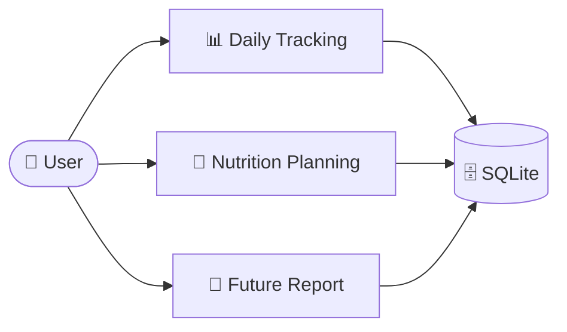
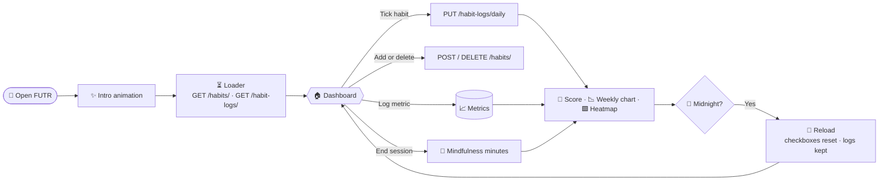
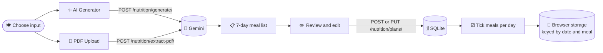
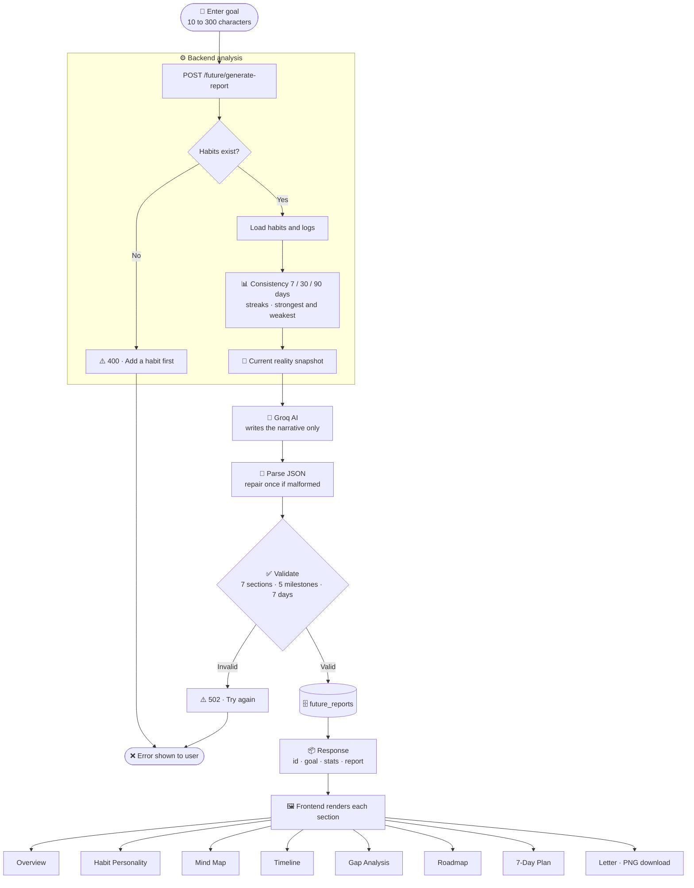
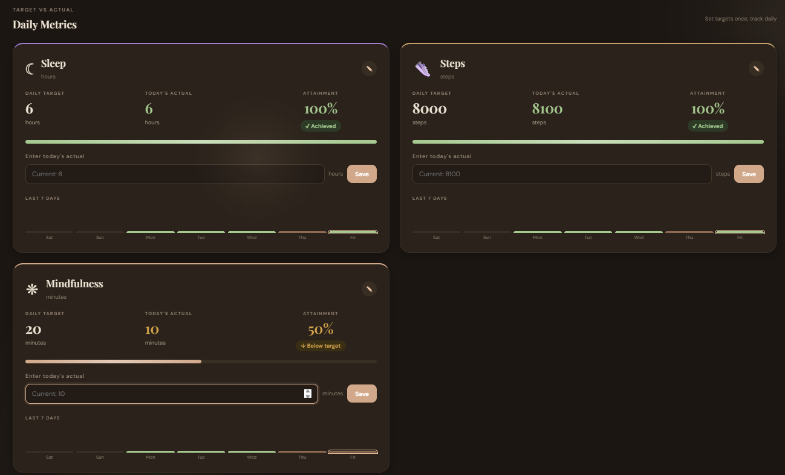

# 🚀 FUTR
### Understand Your Habits. Explore Your Future.

<p align="center">
  <strong>Small actions today. A better future tomorrow.</strong>
  <br />
  A smarter way to track habits, understand your lifestyle, and visualize your future.
</p>

<p align="center">
  
  
  
  
  
  
</p>

<p align="center">
  <a href="https://github.com/adityadubey2211-prog/FUTR">Repository</a> •
  <a href="#-features">Features</a> •
  <a href="#-workflow-pipeline">Workflow</a> •
  <a href="#-getting-started">Installation</a> •
  <a href="#-roadmap">Roadmap</a>
</p>

---

## 🌌 About FUTR

**FUTR** is a personal habit and lifestyle tracking platform built around one idea:

> *Your future is shaped by what you repeatedly do today.*

Most habit trackers only tell you whether a task was completed. FUTR goes further. It measures your consistency over time, turns your real habit history into a personalised **Future Report**, and shows how small daily changes can shape your long-term outcomes.

FUTR brings five areas of personal growth into one place:

- **Habits:** daily checklists with a score and a consistency heatmap.
- **Lifestyle metrics:** sleep, steps and mindfulness with daily targets.
- **Nutrition:** AI-generated or PDF-based 7-day meal plans.
- **Mindfulness:** timed sessions with a breathing visual.
- **Future:** AI-written report, mind map, timeline, plan and a letter from your future self.

---

## ✨ Features

<table>
<tr>
<td width="50%">

### 🎯 Habit Management
- Create habits with a category (Learning, Personal, Fitness, Health).
- Tick habits off for today. Completion is saved per day.
- Daily score ring shows completed habits out of 100.
- Checkboxes reset automatically at midnight. Past days are kept.

</td>
<td width="50%">

### 📊 Dashboard & Analytics
- Weekly wellness chart for the last 7 days.
- Consistency heatmap for the past 365 days, with month labels.
- Analytics tab with weekly average, best day and metric history.
- Live theme switch between light and warm dark mode.

</td>
</tr>
<tr>
<td width="50%">

### 📈 Daily Metrics
- Track **sleep** (hours), **steps** and **mindfulness** (minutes).
- Set a daily target for each metric and log today's actual value.
- Progress bars and attainment percentages.
- Steps read from the phone sensor on Android.

</td>
<td width="50%">

### 🥗 AI Nutrition Planning
- Generate a personalised 7-day plan from your age, goal, diet and budget.
- Or upload a weekly diet PDF and extract meals automatically.
- Review and edit any meal, then save the plan.
- Tick off meals day by day.

</td>
</tr>
<tr>
<td width="50%">

### 🧘 Mindfulness
- Set an intention: 5, 10, 15, 20 or 30 minutes, or any custom value.
- Pause, resume or end a session. Auto-finishes when the target is reached.
- Session minutes are added to today's mindfulness metric.
- Breathing visual for a calm start.

</td>
<td width="50%">

### 🔮 Future Report
- Enter your big goal in plain language.
- The backend reads your real habit logs and computes consistency stats.
- An AI model writes a report: personality, mind map, 5-milestone timeline (3, 6, 12, 24, 36 months), gap analysis, roadmap, 7-day plan and a letter.
- Download the letter as a PNG.

</td>
</tr>
</table>

---

## 🔄 Workflow Pipeline

### Overview



---

### 1️⃣ Daily Tracking



| Stage | What happens | Where |
|---|---|---|
| Load | Habits and logs are fetched at startup | `App.jsx` |
| Record | Each tick is saved for that date | `PUT /habit-logs/daily` |
| Score | Completed ÷ total × 100 | `App.jsx` |
| Visualise | Weekly chart, 365-day heatmap, metric bars | `App.jsx`, `App.css` |
| Reset | Checkboxes clear at local midnight; past logs stay | `App.jsx` |

---

### 2️⃣ Nutrition Planning



---

### 3️⃣ Future Report



**Rules the pipeline enforces**

- ✅ All numbers come from the backend. The frontend never calculates statistics.
- 📅 Consistency counts only days that have a log entry.
- 🌱 A habit with no logs shows "No data", not a failure.
- 🛟 Malformed AI output is repaired once before the request fails.
- 🔁 If generation fails, the user sees a clear message and can retry.

---

## 🖥️ Application Preview

<p align="center">
  
</p>
<p align="center">
  
</p>

---

## ⚙️ Tech Stack

| Category | Technologies |
|---|---|
| Frontend | React, Vite, JavaScript, CSS |
| Backend | Python, FastAPI |
| Database | SQLite, SQLAlchemy |
| Data Validation | Pydantic |
| AI — Nutrition | Google Gemini API |
| AI — Future Report | Groq API |
| Mobile | Capacitor, Android, Java |
| Communication | REST APIs (JSON) |

---

## 🏗️ Architecture

```text
                  ┌──────────────────────────┐
                  │         FUTR UI          │
                  │      React + Vite        │
                  │  Today · Metrics ·       │
                  │  Analytics · Future      │
                  └────────────┬─────────────┘
                               │
                            REST API
                               │
                  ┌────────────▼─────────────┐
                  │      FastAPI Backend     │
                  │                          │
                  │  Routers → Services      │
                  │  Pydantic schemas        │
                  │  Habit & future analysis │
                  └─────┬───────────┬────────┘
                        │           │
                ┌───────▼──┐   ┌────▼─────────────┐
                │ SQLite   │   │ Gemini API       │
                │ Database │   │ Nutrition plans  │
                │          │   ├──────────────────┤
                │          │   │ Groq API         │
                │          │   │ Future Report    │
                └──────────┘   └──────────────────┘

                  ┌──────────────────────────┐
                  │   Android (Capacitor)    │
                  │   Native step sensor     │
                  └──────────────────────────┘
```

---

## 📁 Project Structure

```text
FUTR/
│
├── backend/
│   ├── app/
│   │   ├── models/              SQLAlchemy models (habits, logs, plans, future_reports)
│   │   ├── routers/             API routes (future_report.py, …)
│   │   ├── schemas/             Pydantic request/response models
│   │   ├── services/            Habit analysis, Groq report generation
│   │   ├── database.py
│   │   └── main.py
│   │
│   ├── requirements.txt
│   └── .env                     (not committed)
│
├── frontend/
│   ├── android/                 Capacitor Android project
│   ├── public/
│   ├── src/
│   │   ├── App.jsx              Dashboard, habits, metrics, nutrition, heatmap
│   │   ├── App.css
│   │   ├── Nutrition.css
│   │   ├── Futurereport.jsx     Future Report UI and letter download
│   │   ├── Futurereport.css
│   │   └── Loader.jsx           Startup loader
│   ├── package.json
│   └── capacitor.config.json
│
├── docs/                        Screenshots
├── .gitignore
└── README.md
```

---

## 🚀 Getting Started

### Prerequisites

- Python 3.10+
- Node.js and npm
- Git
- A **Gemini API key** (nutrition planning)
- A **Groq API key** (Future Report)
- Android Studio (optional, for the Android build)

### 1. Clone the Repository

```bash
git clone https://github.com/adityadubey2211-prog/FUTR.git
cd FUTR
```

### 2. Backend Setup

```bash
cd backend
python -m venv venv
```

Activate the environment:

**Windows PowerShell**

```powershell
.\venv\Scripts\Activate.ps1
```

**macOS / Linux**

```bash
source venv/bin/activate
```

Install dependencies and start the server:

```bash
pip install -r requirements.txt
uvicorn app.main:app --reload
```

- Backend: `http://127.0.0.1:8000`
- API docs: `http://127.0.0.1:8000/docs`

### 3. Frontend Setup

Open a second terminal:

```bash
cd frontend
npm install
npm run dev
```

Open the local URL that Vite prints, usually `http://localhost:5173`.

If the backend runs somewhere other than `127.0.0.1:8000`, create `frontend/.env`:

```env
VITE_API_BASE_URL=http://127.0.0.1:8000
```

### 4. Android Setup

From the `frontend` directory:

```bash
npm run build
npx cap sync android
npx cap open android
```

Run the app from Android Studio.

---

## 🔐 Environment Configuration

Create `backend/.env`:

```env
GEMINI_API_KEY=your_gemini_api_key
GROQ_API_KEY=your_groq_api_key
```

| Variable | Used for | Required |
|---|---|---|
| `GEMINI_API_KEY` | Nutrition plan generation and PDF extraction | Yes, for nutrition |
| `GROQ_API_KEY` | Future Report generation | Yes, for Future Report |
| `VITE_API_BASE_URL` | Frontend → backend URL (in `frontend/.env`) | Optional |

> **Important:** Never commit API keys or `.env` files. API keys stay on the backend and are never sent to the browser.

---

## 🧪 Testing the Full Flow

1. Start the backend and frontend.
2. Add at least one habit and tick it for today.
3. Set a target for a metric and save today's value.
4. Generate a nutrition plan, edit a meal and save it.
5. Open the **Future** tab, enter a goal and generate a report.
6. Confirm that the overview numbers match `habit_summary` in the API response at `/docs`.

---

## 🗺️ Roadmap

- [x] Daily habit creation and tracking
- [x] Productivity dashboard with weekly chart
- [x] Consistency analytics
- [x] Activity heatmap with month labels
- [x] Midnight reset for daily habits
- [x] AI-powered weekly nutrition planning
- [x] Mindfulness sessions
- [x] Future Report with timeline, roadmap and letter
- [x] Letter download as PNG
- [x] Capacitor Android integration
- [ ] Manual step entry for web users
- [ ] Enhanced Health Connect integration
- [ ] Saved Future Report history on the backend
- [ ] More detailed lifestyle insights
- [ ] Additional mobile capabilities

---

## 👨‍💻 Developer

<p>
  <strong>Aditya Dubey</strong><br />
  Computer Science & Engineering
</p>

<p>
  <a href="https://github.com/adityadubey2211-prog">
    
  </a>
  <a href="https://linkedin.com/in/aditya-dubey-4182432a4/">
    
  </a>
</p>

---

<p align="center">
  <h2 align="center">🌱 FUTR</h2>
  <strong>Don't just track your days. Shape your future.</strong>
  <br />
  <sub>Built with purpose. Designed for progress.</sub>
</p>