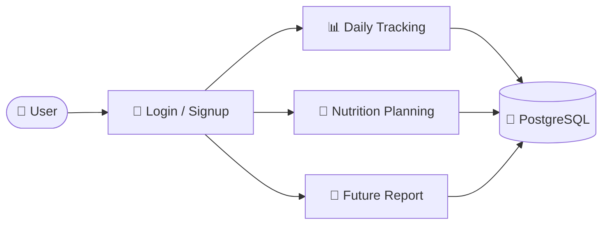
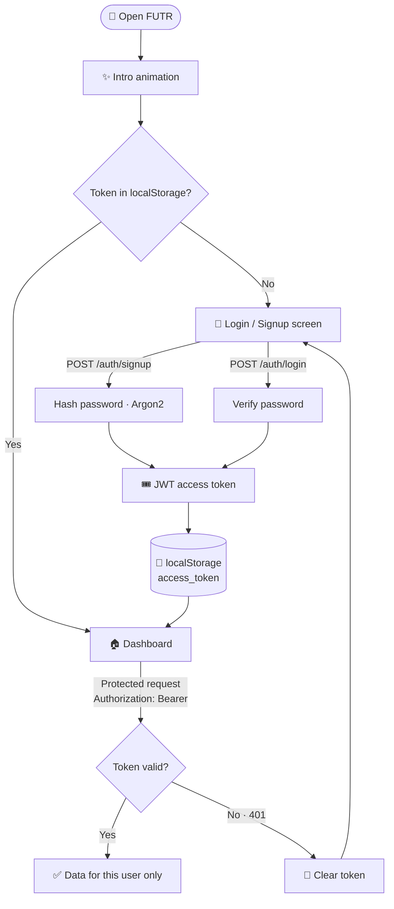
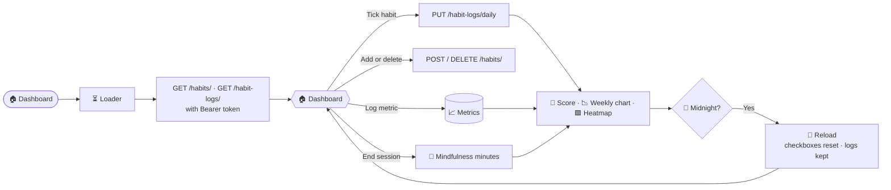
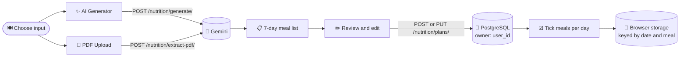
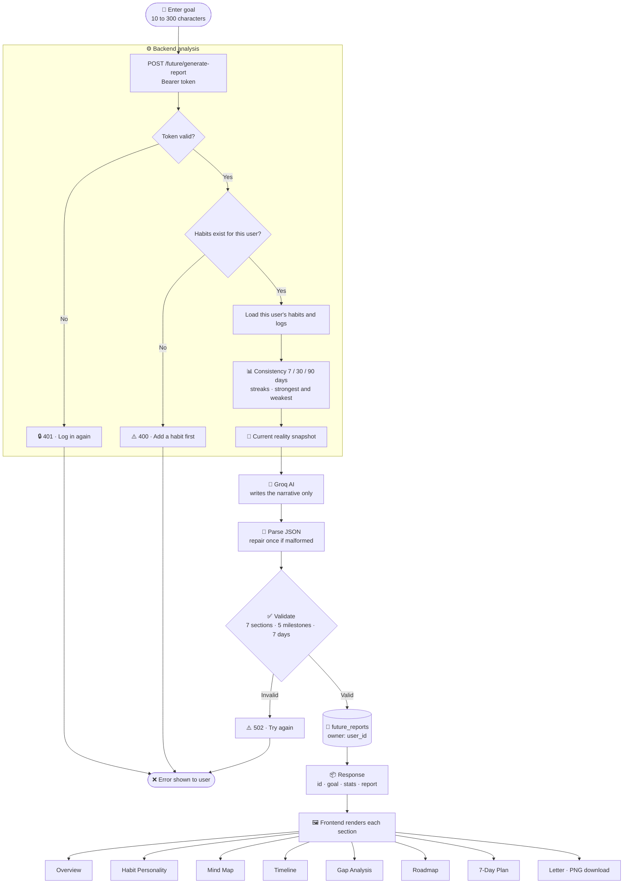
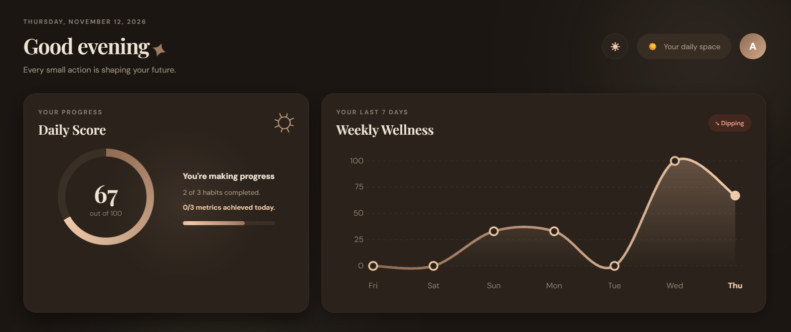
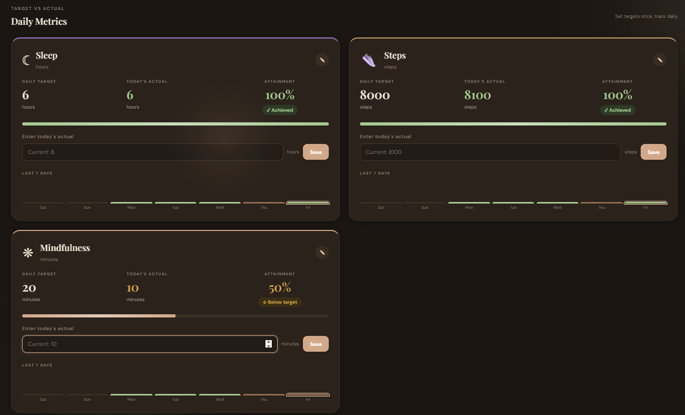

# 🚀 FUTR
### Understand Your Habits. Explore Your Future.

<p align="center">
  <strong>Small actions today. A better future tomorrow.</strong>
  <br />
  A smarter way to track habits, understand your lifestyle, and visualize your future.
</p>

<p align="center">
  
  
  
  
  
  
  
</p>

<p align="center">
  <a href="https://github.com/adityadubey2211-prog/FUTR">Repository</a> •
  <a href="#-features">Features</a> •
  <a href="#-development-progress">Progress</a> •
  <a href="#-workflow-pipeline">Workflow</a> •
  <a href="#-getting-started">Installation</a> •
  <a href="#-roadmap">Roadmap</a>
</p>

---

## 🌌 About FUTR

**FUTR** is a personal habit and lifestyle tracking platform built around one idea:

> *Your future is shaped by what you repeatedly do today.*

Most habit trackers only tell you whether a task was completed. FUTR goes further. It measures your consistency over time, turns your real habit history into a personalised **Future Report**, and shows how small daily changes can shape your long-term outcomes.

FUTR is now a **multi-user application**. Every account has its own habits, logs, diet plans and future reports, and no user can see or change another user's data.

FUTR brings five areas of personal growth into one place:

- **Habits:** daily checklists with a score and a consistency heatmap.
- **Lifestyle metrics:** sleep, steps and mindfulness with daily targets.
- **Nutrition:** AI-generated or PDF-based 7-day meal plans.
- **Mindfulness:** timed sessions with a breathing visual.
- **Future:** AI-written report, mind map, timeline, plan and a letter from your future self.

---

## ✨ Features

<table>
<tr>
<td width="50%">

### 🔐 Accounts & Security
- Sign up and log in with email and password.
- Passwords are hashed with **Argon2**.
- Login returns a **JWT access token**, saved in the browser.
- Every protected request sends `Authorization: Bearer <token>`.
- Logged-in state survives a page refresh.
- Account deletion is available from the backend.

</td>
<td width="50%">

### 🧩 Data Isolation
- Each user sees only their own habits, logs, metrics and plans.
- Update and delete actions check ownership on the server.
- Heatmap, analytics and dashboard are calculated per user.
- Future reports are saved and loaded per user.

</td>
</tr>
<tr>
<td width="50%">

### 🎯 Habit Management
- Create habits with a category (Learning, Personal, Fitness, Health).
- Tick habits off for today. Completion is saved per day.
- Daily score ring shows completed habits out of 100.
- Checkboxes reset automatically at midnight. Past days are kept.

</td>
<td width="50%">

### 📊 Dashboard & Analytics
- Weekly wellness chart for the last 7 days.
- Consistency heatmap for the past 365 days, with month labels.
- Analytics tab with weekly average, best day and metric history.
- Live theme switch between light and warm dark mode.

</td>
</tr>
<tr>
<td width="50%">

### 📈 Daily Metrics
- Track **sleep** (hours), **steps** and **mindfulness** (minutes).
- Set a daily target for each metric and log today's actual value.
- Progress bars and attainment percentages.
- Steps read from the phone sensor on Android.

</td>
<td width="50%">

### 🥗 AI Nutrition Planning
- Generate a personalised 7-day plan from your age, goal, diet and budget.
- Or upload a weekly diet PDF and extract meals automatically.
- Review and edit any meal, then save the plan.
- Tick off meals day by day.

</td>
</tr>
<tr>
<td width="50%">

### 🧘 Mindfulness
- Set an intention: 5, 10, 15, 20 or 30 minutes, or any custom value.
- Pause, resume or end a session. Auto-finishes when the target is reached.
- Session minutes are added to today's mindfulness metric.
- Breathing visual for a calm start.

</td>
<td width="50%">

### 🔮 Future Report
- Enter your big goal in plain language.
- The backend reads your real habit logs and computes consistency stats.
- An AI model writes a report: personality, mind map, 5-milestone timeline (3, 6, 12, 24, 36 months), gap analysis, roadmap, 7-day plan and a letter.
- Download the letter as a PNG.

</td>
</tr>
</table>

---

## 📌 Development Progress

### ✅ Milestone: Multi-User Authentication & Data Isolation

| Area | Status |
|---|---|
| FastAPI backend | ✅ Done |
| PostgreSQL integration | ✅ Done |
| Existing data migrated | ✅ Done |
| Signup and login APIs | ✅ Done |
| Argon2 password hashing | ✅ Done |
| JWT creation and verification | ✅ Done |
| Protected backend routes | ✅ Done |
| Frontend token storage and attachment | ✅ Done |
| Login and signup screen | ✅ Done |
| User-wise data filtering and ownership checks | ✅ Done |
| Account deletion endpoint | ✅ Done |
| Deployment: React frontend | ✅ Deployed |
| Deployment: FastAPI backend | ✅ Deployed |
| Deployment: PostgreSQL | ✅ Connected |

### 🗂️ Backend

- FastAPI setup, SQLAlchemy models and database integration.
- Habits CRUD APIs, habit logs (create, update, delete), daily completion and reset logic.
- Heatmap API, daily score calculation, analytics API and dashboard API.
- Future projection and report generation.
- Nutrition and diet-plan APIs.

### 🛢️ Database (PostgreSQL)

- Tables for habits, habit logs, diet plans, meals and future reports.
- Every user-owned table has a `user_id` column.
- Existing records were kept and assigned to account ID 12.

| Data | Records migrated |
|---|---|
| Habits | 4 |
| Diet plans | 2 |
| Future reports | 10 |
| **Total** | **16, none deleted** |

### 🔒 Authentication & Security

- Signup and login return a JWT access token and the user profile.
- Passwords are stored only as Argon2 hashes.
- The token is verified on every protected route.
- The `user_id` always comes from the verified token, never from the request body.
- Update and delete actions require the record to belong to the logged-in user.

### 🧩 User Data Isolation

- User A sees only User A's habits. User B sees only User B's habits.
- Habit logs are filtered through the owner's habits.
- Nutrition plans, analytics, heatmap, dashboard and future reports are per user.

### 🖥️ Frontend

- React dashboard with habit cards, completion controls, heatmap, analytics and future panel.
- Nutrition interface and mindfulness timer.
- Login and signup screen with validation.
- JWT stored in `localStorage` under `access_token`.
- Protected requests send the Bearer token. A `401` clears the token and returns the user to login.

---

## 🔄 Workflow Pipeline

### Overview



---

### 1️⃣ Authentication



### 2️⃣ Daily Tracking



| Stage | What happens | Where |
|---|---|---|
| Load | Habits and logs are fetched after login | `App.jsx` |
| Record | Each tick is saved for that date, for the owner only | `PUT /habit-logs/daily` |
| Score | Completed ÷ total × 100 | `App.jsx` |
| Visualise | Weekly chart, 365-day heatmap, metric bars | `App.jsx`, `App.css` |
| Reset | Checkboxes clear at local midnight; past logs stay | `App.jsx` |

---

### 3️⃣ Nutrition Planning



---

### 4️⃣ Future Report



**Rules the pipeline enforces**

- ✅ All numbers come from the backend. The frontend never calculates statistics.
- 📅 Consistency counts only days that have a log entry.
- 🌱 A habit with no logs shows "No data", not a failure.
- 🛟 Malformed AI output is repaired once before the request fails.
- 🔁 If generation fails, the user sees a clear message and can retry.
- 🔐 Every query is filtered by the logged-in user's ID.

---

## 🖥️ Application Preview

<p align="center">
  
</p>
<p align="center">
  
</p>

---

## ⚙️ Tech Stack

| Category | Technologies |
|---|---|
| Frontend | React, Vite, JavaScript, CSS |
| Backend | Python, FastAPI |
| Database | PostgreSQL, SQLAlchemy |
| Authentication | JWT (Bearer tokens), Argon2 password hashing |
| Data Validation | Pydantic |
| AI — Nutrition | Google Gemini API |
| AI — Future Report | Groq API |
| Mobile | Capacitor, Android, Java |
| Communication | REST APIs (JSON) |
| Deployment | Frontend, backend and PostgreSQL deployed |

---

## 🏗️ Architecture

```text
                  ┌──────────────────────────┐
                  │         FUTR UI          │
                  │      React + Vite        │
                  │  Login · Today ·         │
                  │  Metrics · Analytics ·   │
                  │  Future                  │
                  └────────────┬─────────────┘
                               │
                 REST API · Authorization: Bearer <JWT>
                               │
                  ┌────────────▼─────────────┐
                  │      FastAPI Backend     │
                  │                          │
                  │  Auth (JWT + Argon2)     │
                  │  Routers → Services      │
                  │  Ownership checks        │
                  │  Pydantic schemas        │
                  └─────┬───────────┬────────┘
                        │           │
                ┌───────▼──────┐  ┌─▼────────────────┐
                │ PostgreSQL   │  │ Gemini API       │
                │ users        │  │ Nutrition plans  │
                │ habits       │  ├──────────────────┤
                │ habit_logs   │  │ Groq API         │
                │ diet_plans   │  │ Future Report    │
                │ future_reports│ └──────────────────┘
                └──────────────┘

                  ┌──────────────────────────┐
                  │   Android (Capacitor)    │
                  │   Native step sensor     │
                  └──────────────────────────┘
```

---

## 📁 Project Structure

```text
FUTR/
│
├── backend/
│   ├── app/
│   │   ├── models/              SQLAlchemy models (users, habits, logs, plans, future_reports)
│   │   ├── routers/             Auth, habits, logs, nutrition, future report, analytics
│   │   ├── schemas/             Pydantic request/response models
│   │   ├── services/            Auth, habit analysis, Groq report generation
│   │   ├── database.py          PostgreSQL connection
│   │   └── main.py
│   │
│   ├── requirements.txt
│   └── .env                     (not committed)
│
├── frontend/
│   ├── android/                 Capacitor Android project
│   ├── public/
│   ├── src/
│   │   ├── App.jsx              Auth gate, dashboard, habits, metrics, nutrition, heatmap
│   │   ├── App.css
│   │   ├── Loginpage.jsx        Login and signup screen
│   │   ├── Loginpage.css
│   │   ├── Nutrition.css
│   │   ├── Futurereport.jsx     Future Report UI and letter download
│   │   ├── Futurereport.css
│   │   ├── Loader.jsx           Startup loader
│   │   └── Loader.css
│   ├── package.json
│   └── capacitor.config.json
│
├── docs/                        Screenshots
├── .gitignore
└── README.md
```

---

## 🚀 Getting Started

### Prerequisites

- Python 3.10+
- Node.js and npm
- PostgreSQL (local or hosted)
- Git
- A **Gemini API key** (nutrition planning)
- A **Groq API key** (Future Report)
- Android Studio (optional, for the Android build)

### 1. Clone the Repository

```bash
git clone https://github.com/adityadubey2211-prog/FUTR.git
cd FUTR
```

### 2. Database Setup

Create a PostgreSQL database, for example `futr`, and note its connection string:

```text
postgresql://<user>:<password>@localhost:5432/futr
```

Set it in `backend/.env` as shown in [Environment Configuration](#-environment-configuration).

### 3. Backend Setup

```bash
cd backend
python -m venv venv
```

Activate the environment:

**Windows PowerShell**

```powershell
.\venv\Scripts\Activate.ps1
```

**macOS / Linux**

```bash
source venv/bin/activate
```

Install dependencies and start the server:

```bash
pip install -r requirements.txt
uvicorn app.main:app --reload
```

- Backend: `http://127.0.0.1:8000`
- API docs: `http://127.0.0.1:8000/docs`

### 4. Frontend Setup

Open a second terminal:

```bash
cd frontend
npm install
npm run dev
```

Open the local URL that Vite prints, usually `http://localhost:5173`.

If the backend runs somewhere other than `127.0.0.1:8000`, create `frontend/.env`:

```env
VITE_API_BASE_URL=http://127.0.0.1:8000
```

### 5. Android Setup

From the `frontend` directory:

```bash
npm run build
npx cap sync android
npx cap open android
```

Run the app from Android Studio.

---

## 🔐 Environment Configuration

Create `backend/.env`:

```env
DATABASE_URL=postgresql://<user>:<password>@localhost:5432/futr
GEMINI_API_KEY=your_gemini_api_key
GROQ_API_KEY=your_groq_api_key
```

Also set your JWT signing secret in the same file, using the variable name your backend config reads.

| Variable | Used for | Required |
|---|---|---|
| `DATABASE_URL` | PostgreSQL connection | Yes |
| JWT secret | Signing and verifying access tokens | Yes |
| `GEMINI_API_KEY` | Nutrition plan generation and PDF extraction | Yes, for nutrition |
| `GROQ_API_KEY` | Future Report generation | Yes, for Future Report |
| `VITE_API_BASE_URL` | Frontend → backend URL (in `frontend/.env`) | Optional |

> **Important:** Never commit API keys, JWT secrets or `.env` files. Keep them on the backend only. The browser stores only the user's access token.

---

## 🧪 Testing the Full Flow

1. Start PostgreSQL, the backend and the frontend.
2. Sign up with a new account, then log in.
3. Add at least one habit and tick it for today.
4. Set a target for a metric and save today's value.
5. Generate a nutrition plan, edit a meal and save it.
6. Open the **Future** tab, enter a goal and generate a report.
7. Confirm that the overview numbers match `habit_summary` in the API response at `/docs`.
8. Log out, then create a second account. Confirm that it shows no habits, plans or reports from the first account.
9. Check that a request without a token returns `401`.

### Isolation checks

| Test | Expected result |
|---|---|
| User A creates a habit, User B logs in | User B does not see it |
| User B sends update or delete for User A's habit ID | `404` |
| Request without a token to `/habits/` | `401` |
| Request with an altered token | `401` |
| User A's nutrition plan viewed as User B | Not shown |

---

## 🗺️ Roadmap

- [x] Daily habit creation and tracking
- [x] Productivity dashboard with weekly chart
- [x] Consistency analytics
- [x] Activity heatmap with month labels
- [x] Midnight reset for daily habits
- [x] AI-powered weekly nutrition planning
- [x] Mindfulness sessions
- [x] Future Report with timeline, roadmap and letter
- [x] Letter download as PNG
- [x] Capacitor Android integration
- [x] Signup and login with JWT
- [x] Argon2 password hashing
- [x] PostgreSQL with per-user ownership
- [x] User data isolation
- [x] Account deletion endpoint
- [x] Frontend and backend deployed
- [ ] Logout button in the dashboard
- [ ] Token refresh and expiry handling
- [ ] Password reset by email
- [ ] Manual step entry for web users
- [ ] Enhanced Health Connect integration
- [ ] Saved Future Report history screen
- [ ] More detailed lifestyle insights

---

## 👨‍💻 Developer

<p>
  <strong>Aditya Dubey</strong><br />
  Computer Science & Engineering
</p>

<p>
  <a href="https://github.com/adityadubey2211-prog">
    
  </a>
  <a href="https://linkedin.com/in/aditya-dubey-4182432a4/">
    
  </a>
</p>

---

<p align="center">
  <h2 align="center">🌱 FUTR</h2>
  <strong>Don't just track your days. Shape your future.</strong>
  <br />
  <sub>Built with purpose. Designed for progress.</sub>
</p>