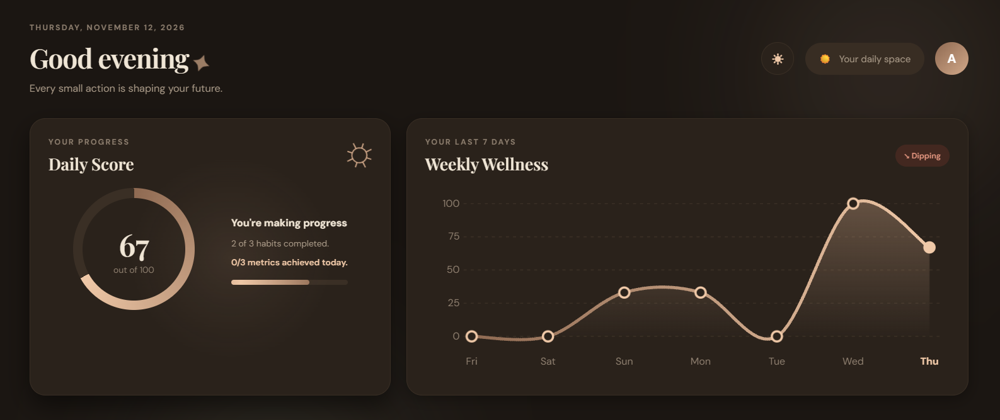
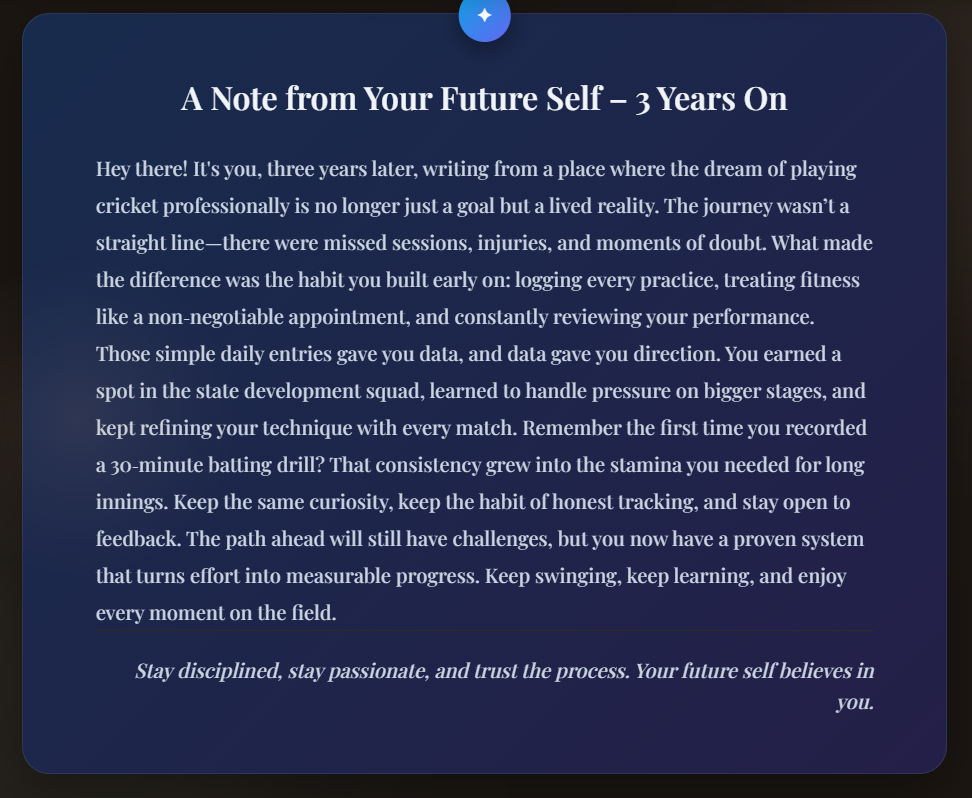

# 🚀 FUTR
### Understand Your Habits. Explore Your Future.

<p align="center">
  <strong>Small actions today. A better future tomorrow.</strong>
  <br />
  A smarter way to track habits, understand your lifestyle, and visualize your future.
</p>

<p align="center">
  
  
  
  
</p>

<p align="center">
  <a href="https://github.com/adityadubey2211-prog/FUTR">Repository</a> •
  <a href="#-features">Features</a> •
  <a href="#-getting-started">Installation</a> •
  <a href="#-roadmap">Roadmap</a>
</p>

---

## 🌌 About FUTR

**FUTR** is a personal habit and lifestyle tracking platform built around one simple idea:

*Your future is shaped by what you repeatedly do today.*

Traditional habit trackers tell you whether you completed a task. FUTR goes a step further — it helps you understand your daily behaviour, measure consistency, and explore how small improvements can influence your long-term future.

With productivity analytics, AI-powered nutrition planning, mindfulness sessions, activity tracking, and future simulations, FUTR brings multiple aspects of personal growth into one platform.

---

## ✨ Features

<table>
<tr>
<td width="50%">

### 🎯 Habit Management
- Create and manage daily habits.
- Mark tasks as completed or pending.
- Track daily performance.
- Build long-term consistency.

</td>
<td width="50%">

### 📊 Productivity Dashboard
- Daily productivity score.
- Habit completion statistics.
- Weekly performance analytics.
- Activity heatmap.

</td>
</tr>
<tr>
<td width="50%">

### 🔮 Future Simulation
- Explore long-term outcomes.
- Simulate different consistency levels.
- Compare current and improved routines.
- Visualize the impact of daily improvements.

</td>
<td width="50%">

### 🥗 AI Nutrition Planning
- Generate personalized 7-day meal plans.
- Powered by Google Gemini.
- Review and edit meal plans.
- Organize meals throughout the week.

</td>
</tr>
<tr>
<td width="50%">

### 🧘 Mindfulness
- Dedicated mindfulness experience.
- Guided breathing visualization.
- Start and track sessions.
- Encourage mindful breaks.

</td>
<td width="50%">

### 👟 Activity Tracking
- Native Android step tracking.
- Device step sensor integration.
- Capacitor-powered mobile support.

</td>
</tr>
</table>

---

## 🖥️ Application Preview

<p align="center">
  
  &nbsp;
  
</p>

## ⚙️ Tech Stack

| Category | Technologies |
|---|---|
| Frontend | React, Vite, JavaScript, CSS |
| Backend | Python, FastAPI |
| Database | SQLite, SQLAlchemy |
| Data Validation | Pydantic |
| AI | Google Gemini API |
| Mobile | Capacitor, Android, Java |
| Communication | REST APIs |

---

## 🏗️ Architecture

```text
                  ┌──────────────────────┐
                  │      FUTR UI         │
                  │   React + Vite       │
                  └──────────┬───────────┘
                             │
                          REST API
                             │
                  ┌──────────▼───────────┐
                  │    FastAPI Backend   │
                  │                      │
                  │  Routes & Services   │
                  │  Business Logic      │
                  │  Data Validation     │
                  └──────┬────────┬──────┘
                         │        │
                  ┌──────▼───┐  ┌─▼────────────┐
                  │ SQLite   │  │ Gemini API   │
                  │ Database │  │ AI Nutrition │
                  └──────────┘  └──────────────┘

                  ┌──────────────────────┐
                  │  Android Integration │
                  │ Capacitor + Sensors  │
                  └──────────────────────┘
```

---

## 📁 Project Structure

```text
FUTR/
│
├── backend/
│   ├── app/
│   │   ├── models/
│   │   ├── routes/
│   │   ├── schemas/
│   │   ├── services/
│   │   ├── database.py
│   │   └── main.py
│   │
│   ├── requirements.txt
│   └── .env
│
├── frontend/
│   ├── android/
│   ├── public/
│   ├── src/
│   ├── package.json
│   └── capacitor.config.json
│
├── .gitignore
└── README.md
```

---

## 🚀 Getting Started

Follow these steps to run FUTR locally.

### Prerequisites

- Python 3.10+
- Node.js and npm
- Git
- Android Studio (optional, for Android development)

### 1. Clone the Repository

```bash
git clone https://github.com/adityadubey2211-prog/FUTR.git
cd FUTR
```

### 2. Backend Setup

```bash
cd backend

python -m venv venv
```

Activate the environment:

**Windows PowerShell**

```powershell
.\venv\Scripts\Activate.ps1
```

Install dependencies:

```bash
pip install -r requirements.txt
```

Create a `.env` file inside the `backend` directory:

```env
GEMINI_API_KEY=your_gemini_api_key
```

Start the backend:

```bash
uvicorn app.main:app --reload
```

Backend: `http://127.0.0.1:8000`

API Documentation: `http://127.0.0.1:8000/docs`

### 3. Frontend Setup

Open a new terminal:

```bash
cd frontend
npm install
npm run dev
```

Open the local URL displayed by Vite.

### 4. Android Setup

From the frontend directory:

```bash
npm run build
npx cap sync android
npx cap open android
```

Run the application through Android Studio.

---

## 🗺️ Roadmap

- [x] Daily habit creation and tracking
- [x] Productivity dashboard
- [x] Consistency analytics
- [x] Activity heatmap
- [x] Future simulation
- [x] AI-powered weekly nutrition planning
- [x] Mindfulness experience
- [x] Capacitor Android integration
- [ ] Manual step entry for web users
- [ ] Enhanced Health Connect integration
- [ ] More detailed lifestyle insights
- [ ] Improved future projections
- [ ] Additional mobile capabilities

---

## 🔐 Environment Configuration

FUTR uses environment variables for external service credentials.

Create a `.env` file inside `backend/`:

```env
GEMINI_API_KEY=your_gemini_api_key
```

**Important:** Never commit API keys, secrets, or environment files to GitHub.

---

## 👨‍💻 Developer

<p>
  <strong>Aditya Dubey</strong><br />
  Computer Science & Engineering
</p>

<p>
  <a href="https://github.com/adityadubey2211-prog">
    
  </a>
  <a href="https://linkedin.com/in/aditya-dubey-4182432a4/">
    
  </a>
</p>

---

<p align="center">
  <h2 align="center">🌱 FUTR</h2>
  <strong>Don't just track your days. Shape your future.</strong>
  <br />
  <sub>Built with purpose. Designed for progress.</sub>
</p>